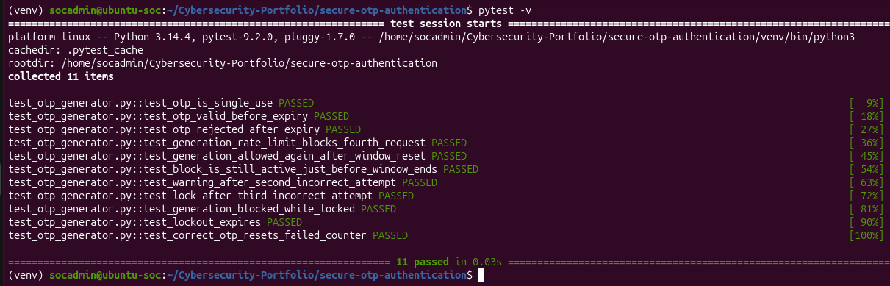
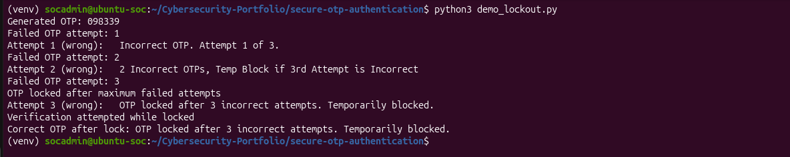

# Secure OTP Authentication and Abuse Detection System

## 1. Project Overview

This project involves the development of a Python-based One-Time Password (OTP) authentication system designed to demonstrate secure authentication principles and the detection of authentication-related security threats.

The project simulates authentication workflows commonly found in financial technology (Fintech) applications and other systems processing sensitive personal information.

The primary focus is on implementing authentication security controls, simulating attacks, analysing security events and developing defensive monitoring capabilities.

## 2. Project Objectives

- Understand Identity and Access Management (IAM).
- Implement secure OTP generation and verification.
- Apply cryptographic principles.
- Implement OTP expiration and replay protection.
- Introduce brute-force prevention.
- Develop security event logging.
- Simulate authentication attacks in a controlled environment.
- Develop SOC detection and investigation capabilities.

## 3. Technology Stack

| Technology | Purpose |
|---|---|
| Python | Application development |
| Ubuntu Linux | Development environment |
| Kali Linux | Controlled security testing |
| Flask | Web application development |
| SQLite | Database management |
| Wazuh | Security monitoring |
| Git/GitHub | Version control and documentation |

## 4. Project Development Progress

| Lab | Description | Status |
|---|---|---|
| Lab 001 | Development environment setup | Completed |
| Lab 002 | Python OTP generation and verification | Completed |
| Lab 003 | OTP security controls and logging | Completed |
| Lab 004 | Authentication attack simulation | Pending |
| Lab 005 | Security log analysis | Pending |
| Lab 006 | Wazuh integration | Pending |

## 5. Implemented Security Controls

The current prototype demonstrates:

- Cryptographically secure OTP generation.
- Six-digit OTP codes.
- SHA-256 OTP hashing.
- OTP expiration after 120 seconds.
- One-time-use enforcement.
- Maximum five incorrect verification attempts.
- Basic OTP generation rate limiting.
- Security event logging.

## 6. Security Monitoring

The project will progressively introduce security monitoring to identify:

- Repeated failed authentication attempts.
- OTP brute-force activity.
- OTP replay attempts.
- Expired OTP submissions.
- Excessive OTP generation requests.
- Suspicious authentication patterns.

## 7. SOC Integration

The intended monitoring platform is Wazuh.

Application security logs will be analysed to identify suspicious activity and generate security alerts.

The investigation process will include event identification, evidence collection, incident classification, impact assessment and recommended remediation.

## 8. Laboratory Environment

All development and testing will take place in an isolated virtual laboratory.

No real customer information, actual voter information or third-party authentication systems will be used.

## 9. Disclaimer

This project is intended strictly for educational and defensive cybersecurity training.

All simulated attacks will be conducted against systems owned and controlled within the laboratory environment.

## Overview

A Python one-time-password (OTP) module that demonstrates common authentication defences: single-use codes, expiry, generation rate limiting, and temporary lockout after repeated incorrect attempts. Every control is covered by an automated pytest test.

## Security Controls

- **Cryptographically secure generation:** OTPs are created with Python's `secrets` module, not `random`.
- **Hashed storage:** only a SHA-256 hash of the active OTP is held in memory.
- **Constant-time comparison:** verification uses `hmac.compare_digest()` to avoid timing side channels.
- **Single use:** an OTP is invalidated immediately after one successful verification.
- **Expiry:** an OTP is valid for 120 seconds.
- **Generation rate limit:** at most 3 OTPs per 60-second sliding window.
- **Lockout:** a warning after the 2nd incorrect attempt (`2 Incorrect OTPs, Temp Block if 3rd Attempt is Incorrect`) and a 300-second temporary block after the 3rd.
- **Security logging:** failed attempts, lockouts, expiry and rate-limit events are logged with timestamps and severity levels.

## Threat -> Control -> Test Result

| Threat | Control | Test | Result |
|---|---|---|---|
| Replay of a used OTP | Single-use invalidation | `test_otp_is_single_use` | Passed |
| Reuse of a stale OTP | 120-second expiry; expired OTP wiped | `test_otp_valid_before_expiry`, `test_otp_rejected_after_expiry` | Passed |
| OTP flooding / repeated regeneration | 3 generations per 60-second window | `test_generation_rate_limit_blocks_fourth_request`, `test_block_is_still_active_just_before_window_ends` | Passed |
| Permanent block after rate limit | Window resets over time | `test_generation_allowed_again_after_window_reset` | Passed |
| Brute-force guessing | Warning on 2nd failure, lock on 3rd | `test_warning_after_second_incorrect_attempt`, `test_lock_after_third_incorrect_attempt` | Passed |
| Escaping a lock by requesting a new OTP | Generation blocked while locked | `test_generation_blocked_while_locked` | Passed |
| Permanent denial of service from lockout | Lockout expires after 300 seconds | `test_lockout_expires` | Passed |
| Failed-attempt counter never clearing | Counter resets after a success | `test_correct_otp_resets_failed_counter` | Passed |
| Predictable OTPs | `secrets` module | Code review | n/a |
| Timing side channel | `hmac.compare_digest()` | Code review | n/a |
| OTP exposed in memory | SHA-256 hashed storage | Code review | n/a |

## Running the Tests

    python3 -m venv venv
    source venv/bin/activate
    pip install pytest
    pytest -v

The tests use an injectable fake clock, so expiry, window reset and lockout expiry are verified instantly without `time.sleep()`.

## Evidence

`demo_lockout.py` shows the lockout flow: the warning message after the second incorrect OTP, a temporary block on the third, and rejection of even t>

## Limitations

- State is held in memory for a single instance. There is no database, so state is lost on restart and the module does not support multiple users or servers.
- The OTP hash is unsalted. Because a 6-digit OTP has only 1,000,000 possible values, a hash of it would be easy to brute-force if memory were exposed. Short expiry and lockout are the main protections.
- There is no delivery channel (SMS or email) and no per-user or per-IP tracking.
- It is a learning project, not production authentication code.

## Possible Improvements

- Per-user state with a persistent store such as Redis
- Salted or HMAC-keyed OTP storage
- TOTP (RFC 6238) support
- Alerting on repeated lockouts

